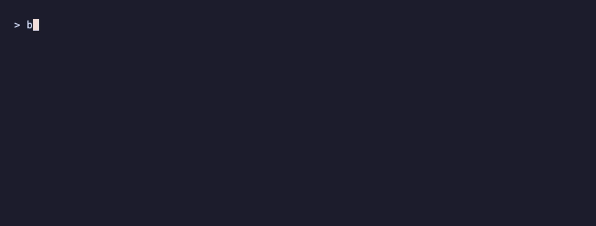
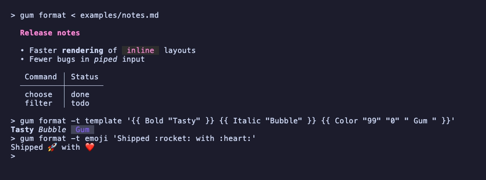
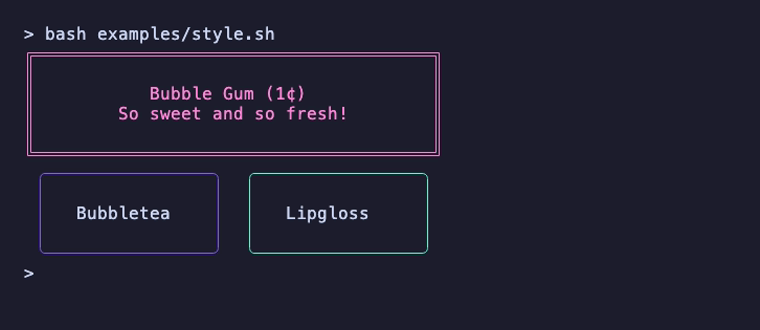

# @oakoliver/gum

A tool for glamorous shell scripts. A TypeScript port of [charmbracelet/gum](https://github.com/charmbracelet/gum) v2.0.2.

<p align="center">
  
</p>

<p align="center"><sub><code>bash examples/commit.sh</code>. The pictures in this README are recorded from the scripts in <code>examples/</code> with <a href="https://github.com/oakoliver/vhs">@oakoliver/vhs</a>; the tapes are in <code>assets/tapes/</code>.</sub></p>

Built on [@oakoliver/bubbletea](https://www.npmjs.com/package/@oakoliver/bubbletea), [@oakoliver/bubbles](https://www.npmjs.com/package/@oakoliver/bubbles), [@oakoliver/lipgloss](https://www.npmjs.com/package/@oakoliver/lipgloss), and [@oakoliver/glamour](https://www.npmjs.com/package/@oakoliver/glamour). Runs on Node.js and Bun.

**Read the article:** [Getting Started with gum: Interactive Shell Scripts](https://engineering.oakoliver.com/articles/getting-started-gum-interactive-shell-scripts)

## Install

```bash
npm install -g @oakoliver/gum
# or run it without installing
npx @oakoliver/gum choose "Yes" "No"
```

## Commands

| Command | Description |
|---------|-------------|
| [`choose`](#choose) | Choose option(s) from a list |
| [`confirm`](#confirm) | Ask a user to confirm an action |
| [`file`](#file) | Pick a file from a folder |
| [`format`](#format) | Format text as markdown, code, emoji, or a template |
| [`input`](#input) | Prompt for a single line of input |
| [`join`](#join) | Join text vertically or horizontally |
| [`log`](#log) | Log a message with a level |
| [`pager`](#pager) | Scroll through content |
| [`spin`](#spin) | Display a spinner while running a command |
| [`style`](#style) | Apply colors, borders, and spacing to text |
| [`table`](#table) | Display and select rows from CSV data |
| [`write`](#write) | Prompt for multi-line input |

`filter` from upstream gum is not implemented yet. See [Upstream parity](#upstream-parity) for what else differs.

Interactive commands draw on stderr and print only the result on stdout, so `RESULT=$(gum choose …)` works. When stdin is piped (for example options for `choose`), keys are read from the terminal. `Ctrl+C` aborts with exit code `130`, `Esc` quits with exit code `1` (`table` exits `0` with an empty row), and `--timeout` (a duration such as `30s`) exits `124`. Every command lists its flags, defaults and style flags with `--help`, for example `gum choose --help`.

<p align="center">
  
</p>

### choose

Choose one option, or several with `--limit` / `--no-limit`. Options come from arguments or from stdin, one per line.

```bash
gum choose "fix" "feat" "docs" "refactor"
gum choose --limit 2 Bubbletea Lipgloss Glamour Huh
ls | gum choose --no-limit --header "Files to delete"
```

Flags: `--limit` (default `1`), `--no-limit`, `--ordered`, `--height` (default `10`), `--cursor` (default `"> "`), `--header` (default `Choose:`), `--selected` (preselected options, comma-separated or repeated; `*` selects all), `--cursor-prefix`, `--selected-prefix`, `--unselected-prefix`, `--select-if-one`, `--input-delimiter`, `--output-delimiter`, `--label-delimiter`, `--padding`, `--show-help`, `--timeout`, plus style flags for `cursor`, `header`, `item`, and `selected` (for example `--cursor.foreground 212`).

### confirm

Exits `0` for the affirmative answer and `1` for the negative one. A piped `yes` or `y` answers without showing a prompt.

```bash
gum confirm "Commit changes?" && git commit -m "$SUMMARY"
```

Flags: `--affirmative` (default `Yes`), `--negative` (default `No`; empty hides the button), `--default` (default `true`), `--show-output`, `--show-help`, `--padding`, `--timeout` (the current choice stands), plus `prompt`, `selected`, and `unselected` style flags.

### file

Browse a directory and print the chosen path.

```bash
$EDITOR "$(gum file ./src)"
```

Flags: `--path` (default `.`), `--all` (show hidden files), `--file` (default `true`), `--directory`, `--height` (default `10`), `--cursor`, `--header`, `--padding`, `--permissions` (default `true`), `--size` (default `true`), `--show-help` (default `true`).

### format

Render text from arguments or stdin.

```bash
gum format -- "# Release notes" "- Faster *rendering*" "- Fewer bugs"
gum format -t template '{{ Bold "Tasty" }} {{ Italic "Bubble" }} {{ Color "99" "0" " Gum " }}'
echo "Shipped :rocket:" | gum format --type emoji
cat main.go | gum format --type code --language go
```

Flags: `--type`/`-t` (`markdown` (default), `code`, `emoji`, `template`), `--theme` (default `pink`), `--language`/`-l`, `--strip-ansi`. `--type code` takes its style from `GLAMOUR_STYLE` (default `dark`). Templates take the styling functions `Bold`, `Faint`, `Italic`, `Underline`, `Blink`, `Reverse`, `CrossOut`, `Overline` (a no-op, as in upstream), `Color`, `Foreground` and `Background`, nested with parentheses; `Color` takes a foreground, or a foreground and a background, before the text. Emoji covers common shortcodes.



### input

```bash
NAME=$(gum input --placeholder "Your name")
TOKEN=$(gum input --password)
```

Flags: `--placeholder` (env `GUM_INPUT_PLACEHOLDER`), `--prompt` (env `GUM_INPUT_PROMPT`), `--value` (or piped stdin), `--char-limit` (default `400`), `--width`, `--password`, `--header`, `--cursor.mode`, `--padding`, `--show-help`, `--timeout`, plus `prompt`, `placeholder`, `cursor`, and `header` style flags.

### join

```bash
gum join "$(gum style --border rounded --padding "1 2" Left)" "$(gum style --border rounded --padding "1 2" Right)"
```

Flags: `--horizontal` (the default), `--vertical`, `--align` (`left`, `center`, `right`, `top`, `middle`, `bottom`).

### log

```bash
gum log --level error "Deploy failed"
gum log --structured --level error "Deploy failed" region eu-west-1 attempt 3
gum log --structured --formatter json --level info "Started" port 8080
```

Flags: `--level`/`-l` (`none` (default), `debug`, `info`, `warn`, `error`, `fatal`; `fatal` exits `1`), `--min-level`, `--formatter` (`text` (default), `json`, `logfmt`), `--structured`/`-s` (the message, then alternating keys and values), `--format`/`-f` (printf verbs), `--prefix`, `--time`/`-t` (a Go layout or a name such as `kitchen`, `rfc3339`, `datetime`), `--file`/`-o` (append there instead of stderr), plus `level`, `time`, `prefix`, `message`, `key`, `value`, and `separator` style flags.

### pager

```bash
gum pager < CHANGELOG.md
```

Flags: `--show-line-numbers` (default `true`), `--soft-wrap` (default `true`), `--border-foreground` (default `212`), `--line-number.foreground`, `--match-highlight.*` style flags.

### spin

Runs the command after `--` and shows a spinner until it exits.

```bash
gum spin --spinner moon --title "Installing..." -- npm install
gum spin --show-output --title "Testing..." -- bun test
```

The command runs directly, without a shell, and its output is hidden unless asked for. The exit code is the command's.

Flags: `--spinner`/`-s` (`dot` (default), `line`, `minidot`, `jump`, `pulse`, `points`, `globe`, `moon`, `monkey`, `meter`, `hamburger`), `--title` (default `Loading...`), `--align`/`-a`, `--show-output`, `--show-stdout`, `--show-stderr`, `--show-error` (print the output if the command fails), `--timeout`.

### style

```bash
gum style --foreground 212 --border-foreground 212 --border double \
  --align center --width 50 --margin "1 2" --padding "2 4" \
  "Bubble Gum (1¢)" "So sweet and so fresh!"
```

Arguments are joined one per line. Colors stay in captured output, so styled blocks compose with `gum join` (see [Colors](#colors)):



Flags: `--foreground`, `--background`, `--border` (`normal`, `rounded`, `double`, `thick`, `hidden`, `none`), `--border-foreground`, `--border-background`, `--align`, `--width`, `--height`, `--margin`, `--padding`, `--bold`, `--faint`, `--italic`, `--strikethrough`, `--underline`, `--trim`, `--strip-ansi`.

### table

Shows CSV from stdin or `--file`, and prints the selected row.

```bash
gum table --file flavors.csv --widths 12,8
cat data.csv | gum table --print
```

Flags: `--file`/`-f`, `--separator`/`-s` (default `,`), `--columns`/`-c`, `--widths`/`-w`, `--height`, `--print`/`-p` (print a bordered table without selecting), `--border`/`-b` (default `rounded`), `--return-column`/`-r`, `--hide-count`, `--show-help` (default `true`), `--padding`, `--timeout`, plus `border`, `cell`, `header`, and `selected` style flags.

### write

```bash
gum write --placeholder "Details of this change" > body.txt
```

`Enter` submits and `Ctrl+J` inserts a newline, as upstream. Opening `$EDITOR` with `Ctrl+E` is not ported.

Flags: `--placeholder` (env `GUM_WRITE_PLACEHOLDER`), `--value` (or piped stdin), `--char-limit` (default `0`, unlimited), `--max-lines`, `--width`, `--height` (default `5`), `--show-line-numbers`, `--prompt`, `--header`, `--cursor.mode`, `--padding`, `--show-help`, `--timeout`, plus `base`, `placeholder`, `prompt`, `cursor`, `cursor-line`, `cursor-line-number`, `line-number`, `end-of-buffer`, and `header` style flags.

## Colors

`style`, `join` and `format` write through a color profile writer, as upstream v2 does. Colors are downgraded to what the terminal supports (`COLORTERM`, `TERM`), `NO_COLOR` removes colors and keeps bold, italic and the like, `TERM=dumb` prints plain text, and `CLICOLOR_FORCE=1` keeps colors where there is no `TERM`. `choose` and `table` strip their result when stdout is not a terminal.

Unlike upstream v2.0.2, `style`, `join` and `format` keep their colors when stdout is a pipe or a command substitution. Upstream strips them there, which breaks `$(gum style …)` and `gum format | less -R` ([gum#1127](https://github.com/charmbracelet/gum/issues/1127), [gum#1131](https://github.com/charmbracelet/gum/issues/1131), both open); this port keeps what v0.17.0 did. Set `NO_COLOR=1` to drop the colors.

## Upstream parity

This port matches [gum v2.0.2](https://github.com/charmbracelet/gum/releases/tag/v2.0.2), which is v0.17.0 plus the move to Bubble Tea and Lip Gloss v2. Upstream calls v2.0.0 a release with no UX changes; the diff shows a few ([CHANGELOG](CHANGELOG.md) lists each). `gum <command> --help` is generated from upstream's v2.0.2 option structs, and the output of `style`, `join` and `format` is checked byte for byte against the real v2.0.2 binary in every color depth (`tests/fixtures/`, regenerated by `scripts/gen-upstream-fixtures.ts`).

Not ported:

- `filter` (the fuzzy matcher is in `src/fuzzy.ts`, the command is not).
- Opening `$EDITOR` with `Ctrl+E` in `write`.
- `completion`, `man` and `version` subcommands, and Go's full `text/template` language in `format` (only the styling functions).

Differs on purpose:

- `style`, `join` and `format` keep their colors in a pipe (see [Colors](#colors)).
- `choose --no-limit` toggles with `Space`. Upstream v2.0.2 does not, because it binds a literal space where Bubble Tea v2 names the key `space` ([gum#1143](https://github.com/charmbracelet/gum/issues/1143)).
- `format` adds a trailing newline, and renders emoji shortcodes from a built-in list rather than with Glamour's emoji extension.
- `table --print` styles the header row. Upstream styles the first data row (it checks `row == 0` against a header that is row -1), as it did in v0.17.0.
- Syntax-highlighted code in `format` uses highlight.js through Glamour, so token colors differ from Chroma's.

Also see the [CHANGELOG](CHANGELOG.md).

## Library use

Each command is also exported as a function that takes parsed arguments:

```typescript
import { parseArgs, runStyle } from '@oakoliver/gum';

await runStyle(parseArgs(['style', '--foreground', '212', 'Hello']));
```

## Part of the Charm Ecosystem for TypeScript

| Package | Description |
|---------|-------------|
| [@oakoliver/lipgloss](https://www.npmjs.com/package/@oakoliver/lipgloss) | CSS-like terminal styling |
| [@oakoliver/bubbletea](https://www.npmjs.com/package/@oakoliver/bubbletea) | Elm Architecture TUI framework |
| [@oakoliver/bubbles](https://www.npmjs.com/package/@oakoliver/bubbles) | TUI components |
| [@oakoliver/glamour](https://www.npmjs.com/package/@oakoliver/glamour) | Terminal markdown rendering |
| [@oakoliver/huh](https://www.npmjs.com/package/@oakoliver/huh) | Terminal forms and prompts |
| [@oakoliver/glow](https://www.npmjs.com/package/@oakoliver/glow) | Terminal markdown reader |
| [@oakoliver/vhs](https://www.npmjs.com/package/@oakoliver/vhs) | Terminal recordings from `.tape` files |

## License

MIT
